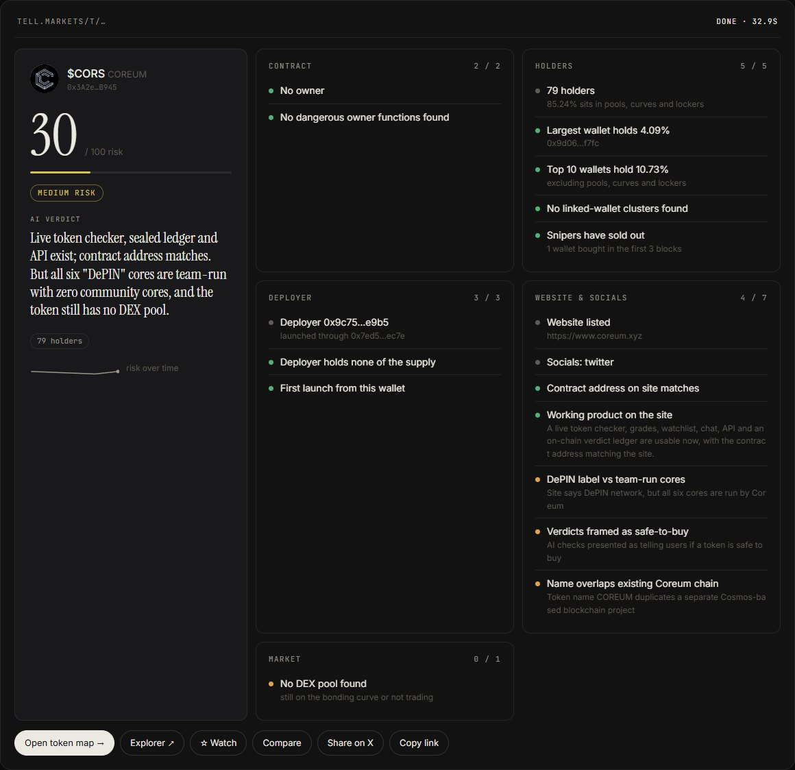
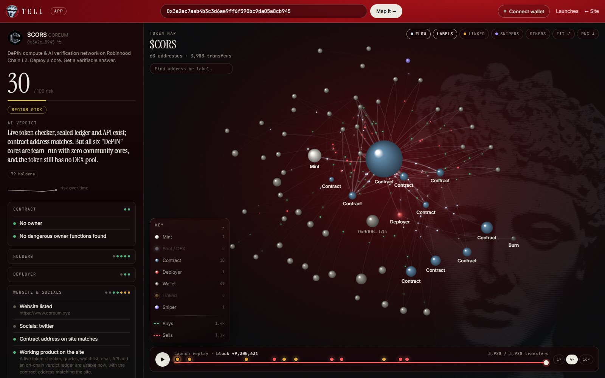
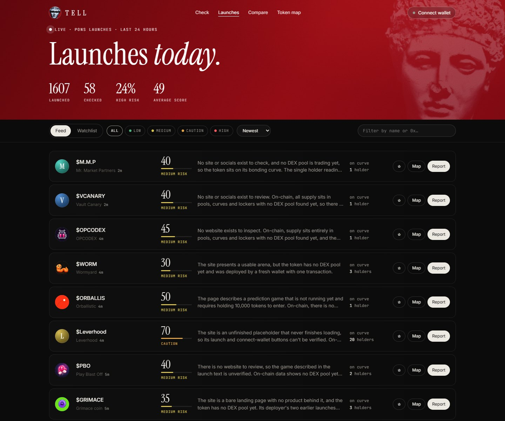
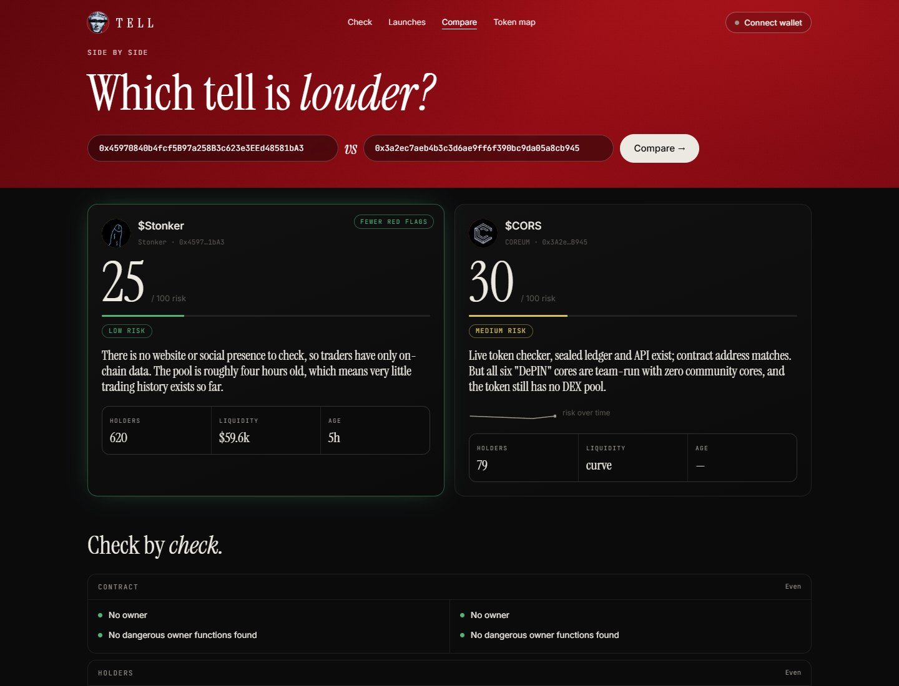

# Tell

**Launch checks for Robinhood Chain.** Paste a token and Tell reads the contract, the holders, the deployer, the project's website and the market, then returns one 0–100 risk score with a plain-language verdict.

Live at [tell.markets](https://tell.markets) · [@tellmarkets](https://x.com/tellmarkets)

> Not financial advice. Tell describes what it finds on chain and on the web, and it can be wrong.


## What it does

### One report per token
Paste an address or a DexScreener link. Every finding is shown with the reason behind it, and an AI verdict sums up the one or two things that matter. Each report has its own link at `/t/<address>`.



### The token map — `/app`
Every transfer since launch as a living graph: the mint, pools and bonding curves, the deployer, linked wallets and snipers. Particles show buys in green and sells in red. Hover the key to highlight a group, click any address for its counterparties, and replay the launch block by block with markers for the moments that matter.



### Launches today — `/launches`
Every new Pons launch of the last 24 hours, picked up as it happens and checked in the background. Filter by risk, sort by score or liquidity, and keep a watchlist.



### Compare — `/compare`
Two tokens side by side, check by check.



### Share cards
Every report link unfurls on X, Telegram and Discord as a generated card.


### The checks

- **Contract** — owner, renounced ownership, mint / blacklist / pause / tax-change functions found in the bytecode (including behind upgradeable proxies). Known assets such as WETH, USDG and Robinhood stock tokens are recognized and not scored like memecoins.
- **Holders** — built from the full transfer history: top-wallet concentration excluding pools, curves and lockers; clusters of wallets seeded from one address; snipers from the first blocks.
- **Deployer** — who launched it, what they still hold, whether they dumped, how fresh the wallet is, and every earlier launch through the same factory.
- **Website** — fetched and read by an LLM: working product or just a waitlist, wallet-harvesting forms, too-good-to-be-true promises, and whether the contract address on the site matches. Image, description and links are also read from the Pons launch transaction for tokens still on a bonding curve.
- **Market** — liquidity, pool age and sell pressure from DexScreener.

Critical findings (an owner who can mint, unlocked liquidity, a site asking for seed phrases) push the score to at least 80 on their own. AI findings can only add risk, never remove it.

### Also

- Score history, watchlist, Share on X, PNG export of the token map.
- Wallet sign-in by message signature (no transaction). `$TELL` holder perks switch on once `TELL_TOKEN` is set.

## Run it locally

Requires Node.js 20+.

```bash
npm install
cp .env.example .env   # then fill in DEEPSEEK_API_KEY
npm start              # http://localhost:3000
```

Check a token from the terminal:

```bash
npm run check -- 0x45C83b37C5BAF4dad26f3845C28295e2DE010962
```

### Configuration

| Variable | |
|---|---|
| `RPC_URL` | Robinhood Chain RPC. The public one works but rate-limits; use a paid endpoint in production. |
| `DEEPSEEK_API_KEY` | Website review and verdict. `ANTHROPIC_API_KEY` works as an alternative. Without either, the verdict is rule-based. |
| `PUBLIC_URL` | Public address, used in share-card links. |
| `LAUNCH_WATCHER` | `off` disables the background `/launches` feed. |
| `TELL_TOKEN`, `TELL_HOLDER_MIN`, `FREE_CHECKS_PER_DAY` | Holder perks and the free tier. Off until the token exists. |

Deployment with Docker and Caddy: see [DEPLOY.md](DEPLOY.md) (in Russian).

**Vercel** works too (`src/server.ts` is picked up as the entrypoint), with two limits of serverless: data lives in a temp dir that is wiped between instances, and the background `/launches` watcher is off unless `LAUNCH_WATCHER=on`. For the live feed, run it on a server.

## How it's built

- **TypeScript on Node**, a single `node:http` server ([src/server.ts](src/server.ts)) — no framework.
- **[viem](https://viem.sh)** for chain reads. Transfer history is pulled with chunked `eth_getLogs` (the public RPC caps a call at 10M blocks and 10k results) behind one rate-limited gate, where background work always yields to checks a person is waiting on.
- **DexScreener** for market data; **DeepSeek** (or Claude) for the website review, with structured JSON output validated before use.
- **resvg** renders the share cards; **d3-force** and a canvas renderer draw the token map.
- Plain HTML/CSS/JS pages in [web/](web/); reports, score history and the launch feed persist as JSON under `data/`.

```
src/
  analyze.ts        one token -> report
  checks/           contract, holders, deployer, market, website
  sources/          rpc, logs, dexscreener, website fetcher, launch metadata
  ai/review.ts      website review + verdict
  flow.ts           token map data
  launches.ts       Pons launch watcher
  og.ts             share cards
web/                index, app, launches, compare
```

## Credits

- Statue: *Marble head of an athlete*, [The Metropolitan Museum of Art](https://www.metmuseum.org/art/collection/search/248579), public domain (CC0). Engraving effect by [scripts/engrave.py](scripts/engrave.py).
- Fonts: Instrument Serif, Inter and JetBrains Mono, SIL Open Font License 1.1.
